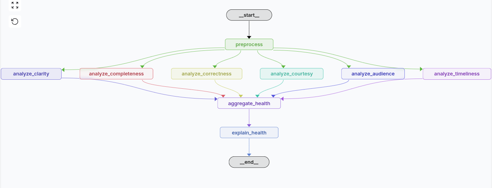

# Communication Health Agent

A LangGraph agent that scores the communication health of an email thread or a meeting transcript. Six LLM nodes run in parallel, each scoring one dimension from 0 to 1 with a short reason. A deterministic node averages the scores, and a final LLM node writes a plain-language summary with recommendations.



## How it works

```
input: email thread or meeting transcript
  -> preprocess      deterministic: participants, timestamps, speakers, one unified text
  -> 6 LLM nodes     in parallel: clarity, completeness, correctness, courtesy, audience, timeliness
  -> aggregate       deterministic: unweighted average of the six scores
  -> explain         LLM: summary and recommendations
  -> JSON result
```

| Dimension | What it measures |
|---|---|
| Clarity | Readability, directness, jargon, brevity |
| Completeness | Whether the needed information and next steps are there |
| Correctness | Accuracy, grammar, logical flow, consistent tone |
| Courtesy | Politeness, respect, professionalism |
| Audience | Relevance and fit for the reader's knowledge and context |
| Timeliness | Timing, response delays, urgency handling |

The six dimensions don't depend on each other, so they run as parallel branches of a LangGraph `StateGraph`. Each analysis node returns structured JSON: `{"score": float, "reasoning": str}`. The input type (emails or transcript) is detected automatically.

## Output

The result has this shape (shortened):

```json
{
  "aggregated_health": {
    "overall": 0.75,
    "dimensions": {"clarity": 0.8, "completeness": 0.7, "correctness": 0.9,
                   "courtesy": 0.75, "audience": 0.7, "timeliness": 0.65}
  },
  "communication_health_scores": {
    "clarity": {"score": 0.8, "reasoning": "The message is clear and direct, with minimal jargon..."},
    "...": {}
  },
  "health_explanation": "Overall, this communication shows strong clarity and correctness...",
  "status": "completed"
}
```

## Run

The model is DeepSeek V3.1 Terminus through NVIDIA NIM (`langchain-nvidia-ai-endpoints`). Create a `.env` file in the project root:

```bash
NVIDIA_API_KEY=your_key
# optional: NVIDIA_MODEL=deepseek-ai/deepseek-v3.1-terminus
```

With Docker:

```bash
docker compose up --build
```

Or with Python 3.10+:

```bash
python -m venv .venv && source .venv/bin/activate
pip install -r requirements.txt
langgraph dev --port 8123
```

Both start the LangGraph server on port 8123 and print a LangGraph Studio link. Open it, paste the contents of a sample file into the input and submit. Each node's result shows up as it runs.

Sample inputs are in `examples/example_communication_files/`: five email threads and two meeting transcripts.

## Project layout

| Path | Contents |
|---|---|
| `var_comm_health/workflow.py` | The LangGraph workflow: nodes, prompts, state and edges |
| `var_comm_health/llm_factory.py` | LLM client setup |
| `var_comm_health/config.py` | Settings, read from `.env` |
| `var_comm_health/langgraph_studio_server.py` | Entry point for LangGraph Studio |
| `langgraph.json` | LangGraph server configuration |
| `examples/` | Sample emails and meeting transcripts |

## License

MIT
